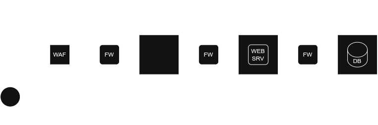
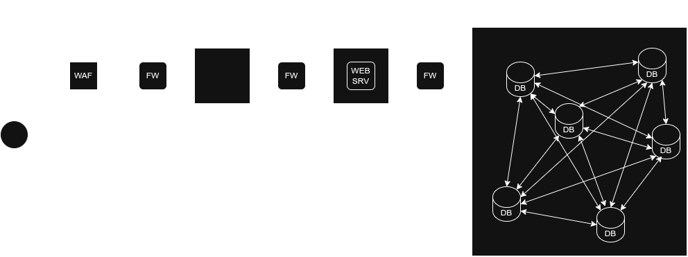
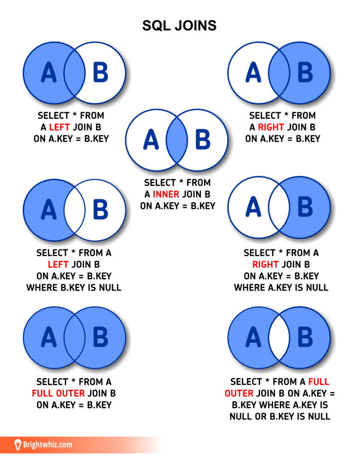
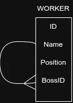
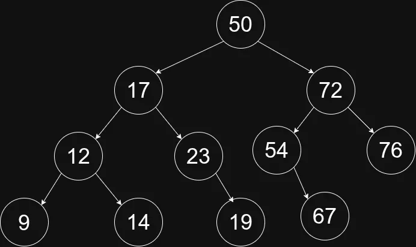

# Adatbázisok 2

- RDBMS (adatbázis keelő softwares)
- SQL
- relational
- fagráf
- sík és térbeli obijektumok

## Oracle Database
- Oracle Database Standard Edition One
- Oracle Database Standard Edition 2 (SE2) [17 500 USD]
- Oracle Database 11g Enterprise Edition [47 500 USD]

Évente ~ 7 millió

### Oracle 1
> 1970 CIA program keretében született meg, a cél egy tudásbázis megalkotása volt
> A projekt megszűnt de a programozók '83-ban összeálltak a Software Development Laboratories cég alatt, amit végül Oracle Corporation néven jegyeztek.

- Szerver kliens architektúra (a kliens tudja csak felvenni a kapcsolatot a szerverrel fordítva nem, több kliens is lehet)

- hive mode: nem egy fizikai szerveren, hanem elosztot-rendszer (horizontális) módban több node-on futnak az adatbázis kezelők amik szinkronizálnak egymással

### Oracle 2
- korszerű
- lehet több task-os, több felhasználós (adatok eggyütt elérése)
- sok platformon elérhető
- elosztott rendszernél is képes működni
- Terméketámogatást
- Magasabb szintű adat véfelem (integrigtás konzisztencia)
- Napi 24 órában képes működni
- Összetett struktúrák tárolására is alkalmas (multimédia, obijektumok, eljárások)

### Oracle 3
- PL/SQL: procedurális elemekkel bővített SQL, csak az ORACLE-re
    * vezérlési szerkezetek
    * Létezik elágazás
    * Eljŕások definiálhatók
    * Változókat deklarálhatunk
    
> Az így kapott programok, tárolhatók és futatthatók szerver vagy kliens oldalon

- Designer; sématervező és kódgeneráló eszköz minden ODBC kompatibilis adatbáziskezelővel
- Warehouse Builder: eszköz adattárház fejlesztés támogatására és tervezésre

### Oracle logikai felépítése 1
- Az adatbázisokat táblahelyekre (táblaterekre) oszthatjuk
- Ez a legmagasabb tárolási egység
- A hasonló működésű és karbantartást adatok kerülnek egy táblahelyre
- blokokkra osztjuk, minden blokk azonos méretű

### Oracle logikai felépítése 2

### Oracle logikai felépítése 3
- Szegmensek tipúsai
    * Adatszegmens
    * Indexszegmens
    * Ideiglenes szegmens
    * Rollback szegmens

Egy szegmens több adatállományon átnyúlhat

### Oracle logikai felépítése 5
- Vissza a tábla helyekhez
    * Lehetőséget biztosít arra hogy meghatározzhasssuk, hogy az adatokat hol helyezzük el, milyen tárolási egységek között.
    * Minden rendszerben van legalább egy system nevű táblahely, de egy rendsze ettől ***több táblahelyet is tartalmazhat, ami nem csak lehetőség, hanem elvárás is.***
    * tipikus rendszer táblahelyek:
    	* rbs
    	* sydstem
    	* sysaux
    	* temp
    	* tools
    	* users

### Oracle logikai felépítése 6
- Adatszótár (Data Dictionary)
- Csoport (Group)

## SQL
### Az SQL nyelv 9
inner, outer, left, right, joins...

### Az SQL nyelv 10
- Where
- Group by
- Having
- Order by 

### Az SQL nyelv 11
alter,delete, ...
### Az SQL nyelv 12
DDL - Adat Definíciós nyelv
create

### SQL parancsok összefoglalás

### Distinct, Union, Minus
Egyedi, Únió, Kivéve

### Hierarchykus adatbázis tervezés

### Aggregációs függvények
### Hasznos függvények
- szövegkezelésre
    * SUBSTR(), REPALCE(), REGEXP_LIKE()
    * LENGTH() - NULL értékre mi az eredmény
- dátumkezelésre
    * TRUNC(), FIRST_DAY(), LAST_DAY()
    * ADD_MOTHS()
    * TO_DATE(), TO_CHAR()
- számkezellésre
    * ROUND(), MOD()

(Érdemes szökő évente februárban tesztelni)

SELECT t.*, (SELECT t.* FROM dual t)
	FROM (SELECT *
		FROM (SELECT t.* from dual t) t1
			CROSS JOIN
			(SELECT t.* from dual t) t2
	) t

## Tranzakciókezelés Alapjai
ACID elvek - atomicity, consistency, isolation, durability

Auto Commit (nem ajánlott)

## ORACLE jogosultságkezelés Alapjai
***A WEB server sose kaphat privilegizált user-t adatbázis kezelőnkben!***

ez egy fa, ez egy fa, ez egy fa, ez egy fa, ez egy fa fa fa fa fa!

futanet.hu (azokat a gmail fiókokat szerezték meg amiknek ugyan az volt a jelszava mint ezen az oldolon, ahol plain textbe voltak elmentve)

pen tessztek

## Oracle Obijektum
- legfeljebb 30 char hosszú (általában főnév)
- kis- nagybetűk nincsenek megkülönböztetve
- rendszerint alulvonással vannak tagolva

(CLEAN CODE alapelvek)

- obijektumok defincioi: Data Dictionary a SYSTEM tablespace-ben
- deafault tároló helyük a USERS
- XML objectek is lehetnek

> "a tömörítés növeli az olvasási sebességet" (elírás a ppt-ben)

### Táblák
- COMPRESS (a NOCOMPRESS a default) a táblák összenyomhatók
- index
- particionálhatók logikailag és fizikailag is (multitenant rendszerek)
- Párhuzamosság PARALLEL <szám> vagy NOPARALLEL

#### multitenancy
|Feature|Single-Tenant|Multi-Tenant|
|--- |--- |--- |
|Infrastructure|Separate for each tenant|Shared infrastructure|
|Cost|Higher per tenant|Lower per tenant|
|Security|Higher isolation|Requires strong access control|
|Scalability|Less scalable|Highly scalable|

- COMMIT és ROLLBACK
- ideiglenes táblák

### View
munka eszköz

cascade-el vigyázzni kell

 

### Indexek - `INDEX`
Vannak adatok amiknek nagyobb az értéke mint a többinek amivel egy táblán/halmazon osztozik. Ezeket gyorsabban szeretnénk elérni, ezt segítendően használjuk az indexeket

lasítja a törlést, frissítést és a beszúrást, de gyorsítja a  lekérdezést

B-fákat (bináris fagráf) használ, feltérképezi az értékeket és szomszédait (linkelt listára hasonlít). Ezeket a fákat minden egyes insertnél ellenőrizni kell és módosítani szükség szerint.

Fontos hogy ezeket mindig optimalizálni kell

#### Példa
50,
17,72,
12,23,54,76,
9,14,19,67,

|RccP|LP|RP|
|:-:|:-:|:-:|
|50|17|72|
|17|12|23|

### Megszorítások - `CONSTRAINT`
- NOT NULL (nem lehet üres)
- CHECK, UNIQUE (mezők érték készletére)
- PRIMARY KEY, FOREIGN KEY (táblák közti hivatkozások)

- el lehet nevezni őket
- van hogy prodban már nincsenek bekapcsolva performancia javítás okán

- a primary key és a unique értékeket alapértelmezetten indexeli az adatbázis azẃrt, hogy rögtön meg lehessen nézni, hogy van-e már ilyen amikor egy újjat akarunk beszúrni!

